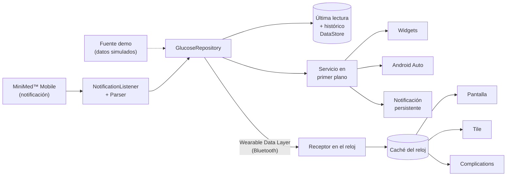
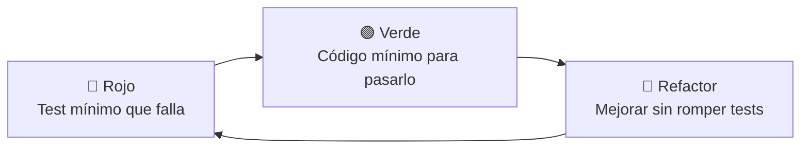

# GlucoWatch

**La glucosa de un vistazo en el reloj, en la pantalla de inicio del móvil y en el coche, sin pasar por la nube.**

GlucoWatch es una aplicación Android (móvil + reloj Wear OS) que lee el valor de glucosa que publica la app oficial **MiniMed™ Mobile** en su notificación y lo lleva, en tiempo real y de forma 100 % local, a un reloj Wear OS, a widgets de la pantalla de inicio y a Android Auto.

> 📌 **Esta no es la versión final del proyecto.** Es una **primera entrega de planteamiento**, realizada para cumplir con el plazo de entrega de FUNDAE. Describe qué se va a construir, qué problema resuelve, con qué tecnologías y cómo se va a desarrollar y desplegar. El código, el despliegue, las slides y el vídeo se irán añadiendo en las siguientes fases (ver [Hoja de ruta](#12-hoja-de-ruta)), y este documento se actualizará en consecuencia.

> ⚠️ **No es un dispositivo médico.** GlucoWatch es un visor de comodidad. El dato mostrado puede llegar con retraso, quedarse congelado o ser erróneo. Las decisiones de tratamiento se toman siempre con la bomba y la app oficial, y las alarmas de hipo/hiperglucemia de la app oficial deben seguir activas.

---

## Índice

1. [Descripción general](#1-descripción-general)
    - [Motivación](#motivación)
    - [Limitaciones para la corrección](#limitaciones-para-la-corrección)
2. [El problema](#2-el-problema)
3. [La solución](#3-la-solución)
4. [Funcionalidades principales](#4-funcionalidades-principales)
    - [Transversales (todas las superficies)](#transversales-todas-las-superficies)
    - [App del móvil](#app-del-móvil)
    - [App del reloj (Wear OS)](#app-del-reloj-wear-os)
    - [Widgets del móvil](#widgets-del-móvil)
    - [Android Auto](#android-auto)
5. [Arquitectura](#5-arquitectura)
    - [Flujo de datos](#flujo-de-datos)
    - [Decisiones de diseño](#decisiones-de-diseño)
6. [Stack tecnológico](#6-stack-tecnológico)
7. [Desarrollo asistido por IA](#7-desarrollo-asistido-por-ia)
    - [7.1 Skills](#71-skills)
    - [7.2 Agentes](#72-agentes)
    - [7.3 Tests con TDD](#73-tests-con-tdd)
    - [7.4 Revisión humana](#74-revisión-humana)
8. [Estructura del proyecto](#8-estructura-del-proyecto)
9. [Instalación y ejecución](#9-instalación-y-ejecución)
    - [Requisitos](#requisitos)
    - [Compilar desde el código (previsto)](#compilar-desde-el-código-previsto)
    - [Opción A · Instalar desde GitHub Releases (APK)](#opción-a--instalar-desde-github-releases-apk)
    - [Opción B · Instalar desde Google Play (prueba interna)](#opción-b--instalar-desde-google-play-prueba-interna)
    - [Primer uso (ambas opciones)](#primer-uso-ambas-opciones)
10. [Despliegue](#10-despliegue)
    - [Canal 1 · GitHub Releases](#canal-1--github-releases)
    - [Canal 2 · Google Play, prueba interna](#canal-2--google-play-prueba-interna)
    - [Canal 3 · Google Play, producción (futuro)](#canal-3--google-play-producción-futuro)
    - [Firma y compatibilidad entre canales](#firma-y-compatibilidad-entre-canales)
    - [Integración continua](#integración-continua)
11. [Seguridad y privacidad](#11-seguridad-y-privacidad)
12. [Hoja de ruta](#12-hoja-de-ruta)
13. [Riesgos y limitaciones conocidas](#13-riesgos-y-limitaciones-conocidas)
14. [Usuario y contraseña de prueba](#14-usuario-y-contraseña-de-prueba)
15. [Entregables del TFM](#15-entregables-del-tfm)
16. [Autor y aviso legal](#16-autor-y-aviso-legal)

---

## 1. Descripción general

| | |
|---|---|
| **Tipo de software** | Aplicación nativa Android, formada por una app de móvil y una app de reloj Wear OS |
| **Usuario objetivo** | Personas con bomba de insulina MiniMed™ 780G que usan la app MiniMed™ Mobile en un móvil Android y llevan un reloj Wear OS |
| **Propuesta de valor** | Consultar la glucosa sin sacar el móvil: con un giro de muñeca, en la pantalla de inicio o en la pantalla del coche |
| **Principio de diseño** | Todo en local: notificación → móvil → Bluetooth → reloj. Sin servidores, sin cuentas, sin nube |

### Motivación

El proyecto nace de una necesidad real: un familiar con diabetes tipo 1 usa una bomba MiniMed™ 780G, un móvil Android y un reloj Wear OS. Para consultar su glucosa tiene que desbloquear el móvil y abrir la app oficial varias veces al día, también mientras conduce. GlucoWatch quiere resolver exactamente ese caso de uso y, de paso, ser útil para cualquier persona en su misma situación.

### Limitaciones para la corrección

Soy consciente de que es un caso de uso muy específico, casi de nicho: para probarlo de verdad hacen falta una bomba MiniMed™ 780G con su app, un móvil Android y un reloj Wear OS, y lo más probable es que no se disponga de todo ello durante la corrección. Por eso el proyecto incluye desde el principio un **modo demostración** con datos simulados, que permite probar la app en cualquier móvil o emulador. Eso sí, en el móvil solo se puede comprobar la recepción y la visualización del dato; para ver la parte del reloj o de Android Auto hace falta disponer de un reloj Wear OS o de un vehículo con Android Auto. Por eso se complementa con el **vídeo**, que mostrará el funcionamiento real en el móvil, el reloj y Android Auto. Como alternativa sin hardware, ambas partes también pueden probarse en el ordenador: el reloj con el **emulador de Wear OS** de Android Studio, y Android Auto con el **Desktop Head Unit (DHU)**, el simulador oficial de Google.

---

## 2. El problema

- La app oficial MiniMed™ Mobile muestra la glucosa del sensor en el móvil, pero **su integración oficial con reloj está pensada para Apple Watch**; los usuarios de Android con reloj Wear OS no tienen una forma oficial de ver el valor en la esfera.
- Mirar el móvil cada pocos minutos es **incómodo y poco discreto** (en clase, en el trabajo, haciendo deporte).
- **Mientras se conduce**, desbloquear el móvil es directamente peligroso; Android Auto no muestra la glucosa.
- Las alternativas existentes suelen depender de **subir los datos a la nube** (servicios de terceros o propios), con la configuración, el coste y la exposición de datos de salud que eso implica.

## 3. La solución

GlucoWatch se apoya en algo que la app oficial ya hace: **publicar una notificación persistente con la glucosa actual y la tendencia**.

1. La app del móvil se registra como **servicio de escucha de notificaciones** (`NotificationListenerService`) y, cuando MiniMed™ Mobile actualiza su notificación (~cada 5 min), extrae el valor, la flecha de tendencia y la hora.
2. Ese dato se normaliza a un **modelo común** (`GlucoseReading`) y se guarda localmente junto con un pequeño histórico.
3. Desde ahí se **distribuye** a todas las superficies:
   - al **reloj Wear OS** por Bluetooth mediante la *Wearable Data Layer API*;
   - a los **widgets** de la pantalla de inicio del móvil;
   - a **Android Auto**.
4. Todas las superficies muestran el dato con **las mismas reglas visuales**: color por rango (hipo / en rango / hiper) y aviso claro cuando el dato es antiguo.

La lectura se diseña detrás de una abstracción (`GlucoseDataSource`), de modo que en el futuro se pueda añadir otra fuente de datos (por ejemplo, Nightscout) sin tocar nada de lo que hay "río abajo".

---

## 4. Funcionalidades principales

Prioridades: **🟢 Imprescindible** (MVP del TFM) · **🟡 Deseable** · **⚪ Futuro** (fuera del alcance del TFM).

### Transversales (todas las superficies)

| Funcionalidad | Prioridad |
|---|---|
| Valor de glucosa (mg/dL) + flecha de tendencia | 🟢 |
| Color por rango: rojo < 70, verde 70–180, ámbar > 180 mg/dL | 🟢 |
| Tres niveles de frescura del dato: **fresco** (< 10 min), **obsoleto** (10–30 min, gris + ⚠), **muy viejo** (≥ 30 min, se oculta el número → "Sin datos recientes") | 🟢 |
| Color de aviso de "dato viejo" distinto del rojo de hipoglucemia, para que no se confundan de reojo | 🟢 |
| Hora de la lectura y "hace X min" | 🟢 |
| Umbrales de rango configurables desde la app | ⚪ |

### App del móvil

| Funcionalidad | Prioridad |
|---|---|
| Lectura de la notificación de MiniMed™ Mobile y parseo robusto del valor/tendencia/hora | 🟢 |
| Pantalla principal con la última lectura y el estado de la sincronización | 🟢 |
| Servicio en primer plano que mantiene la sincronización viva en segundo plano y tras reiniciar | 🟢 |
| Notificación persistente propia que muestra la glucosa | 🟢 |
| Asistente de primer uso: permiso de acceso a notificaciones, batería sin restricciones, emparejamiento con el reloj | 🟢 |
| **Modo demostración** con datos simulados, claramente etiquetado, para probar la app sin bomba | 🟢 |
| Histórico local (~6 h) y gráfica "Últimas 6 horas" con banda de rango objetivo | 🟡 |
| Botón **"Instalar en el reloj"** si hay un reloj emparejado sin la app (abre el Play Store del reloj) | 🟡 |
| Aviso de versión nueva disponible en GitHub Releases (para instalaciones por APK) | 🟡 |
| Exportar el histórico (CSV) | ⚪ |

### App del reloj (Wear OS)

| Funcionalidad | Prioridad |
|---|---|
| Recepción de las lecturas desde el móvil (Data Layer) y caché local | 🟢 |
| Pantalla principal con valor, flecha, hora y antigüedad | 🟢 |
| **Complications** para la esfera: glucosa + flecha, solo glucosa, solo flecha, hora, "hace X min"… | 🟢 |
| **Tile** con la glucosa | 🟢 |
| Refresco periódico para que el paso a "obsoleto" ocurra aunque no llegue dato nuevo | 🟢 |
| Vibración en el reloj al entrar en hipo/hiper | ⚪ |

### Widgets del móvil

| Widget | Contenido | Prioridad |
|---|---|---|
| Glucosa | valor + flecha (1×1) | 🟢 |
| Glucosa + hora | valor + flecha + hora (2×1) | 🟡 |
| Glucosa + tiempo | valor + flecha + "hace X min" (2×1) | 🟡 |
| Completo | todo lo anterior (2×2) | 🟢 |

Todos redimensionables, con vista previa real en el selector de widgets y borde de aviso cuando el dato no es fresco.

### Android Auto

| Vía | Descripción | Prioridad |
|---|---|---|
| App de plantillas (Car App Library) | Pantalla en el launcher de Android Auto con glucosa, flecha, hora y antigüedad | 🟢 |
| Notificación en Android Auto | Aviso que **solo suena al entrar** en hipo o hiper, no en cada actualización | 🟡 |
| Panel lateral (sesión multimedia) | Glucosa fija en el hueco de los controles de música, activable con un interruptor | 🟡 |

---

## 5. Arquitectura

El proyecto se organiza en **tres módulos Gradle**:

- **`shared`** — Kotlin puro, sin dependencias de Android. Modelo de dominio (`GlucoseReading`, `TrendDirection`), reglas de rango y frescura, la interfaz `GlucoseDataSource` y el contrato de sincronización móvil ↔ reloj. Es el módulo más fácil de testear.
- **`mobile`** — App del móvil: fuentes de datos (notificación de MiniMed™ y demo), repositorio, persistencia, servicio en primer plano, widgets y Android Auto.
- **`wear`** — App del reloj: servicio receptor del Data Layer, caché local, pantalla, tile y complications.

### Flujo de datos



### Decisiones de diseño

| Decisión | Motivo |
|---|---|
| Leer la notificación en lugar de una API | MiniMed™ no ofrece una API pública local; la notificación es la única vía 100 % local y sin credenciales |
| Abstracción `GlucoseDataSource` | Aísla la parte frágil (el parseo) y permite añadir otras fuentes sin cambiar el resto |
| Estado reactivo con `StateFlow` | Una única fuente de verdad que todas las superficies observan |
| Reglas de rango/frescura en `shared` | El móvil y el reloj pintan exactamente igual; se testean una sola vez |
| Sin backend | Privacidad de datos de salud, coste cero y funcionamiento sin cobertura |
| Mismo `applicationId` en móvil y reloj | Requisito del Data Layer para que ambas apps se comuniquen |

---

## 6. Stack tecnológico

| Área | Tecnología |
|---|---|
| Lenguaje | **Kotlin** (2.3.x), JDK 17 |
| Build | **Gradle** con Kotlin DSL, *version catalog* (`libs.versions.toml`), Android Gradle Plugin 9.x |
| IDE | **Android Studio** |
| UI del móvil | **Jetpack Compose** + Material 3 |
| UI del reloj | **Compose for Wear OS** |
| Tile del reloj | **Wear Tiles** + **ProtoLayout** |
| Complications | **Watch Face Complications Data Source** (AndroidX) |
| Comunicación móvil ↔ reloj | **Wearable Data Layer API** (Google Play Services) |
| Lectura de datos | `NotificationListenerService` (API de Android) |
| Concurrencia | **Kotlin Coroutines** + **Flow** |
| Persistencia | **Jetpack DataStore** + **kotlinx.serialization** |
| Widgets | **App Widgets** de Android (RemoteViews) |
| Android Auto | **Car App Library** (plantillas) + **MediaSession** (panel lateral) |
| Testing | **JUnit** + **kotlinx-coroutines-test**, desarrollo guiado por tests (**TDD**) |
| Control de versiones | **Git** + **GitHub** |
| CI/CD | **GitHub Actions** (compilación, tests, *App Bundle* y APK) |
| Distribución | **GitHub Releases** (APK) y **Google Play** (prueba interna; producción en el futuro) |
| Desarrollo asistido | **IA generativa** (Claude) con skills y agentes propios — ver sección siguiente |

**Plataformas objetivo:** móvil Android 8.0+ (API 26) y reloj Wear OS 3+ (API 30), compilando contra el SDK más reciente.

---

## 7. Desarrollo asistido por IA

El proyecto se desarrolla con un asistente de IA (Claude) que no se usa solo como generador de código: se le **configura** para este proyecto con skills, agentes y una disciplina de tests estricta.

### 7.1 Skills

Una *skill* es un paquete de instrucciones reutilizable que le enseña a la IA a hacer bien una tarea concreta del proyecto, siempre de la misma forma. Skills previstas:

| Skill | Para qué sirve |
|---|---|
| `tdd-kotlin` | Impone el ciclo TDD (ver 7.3) en cualquier funcionalidad nueva |
| `nueva-superficie` | Pasos para añadir una superficie que muestre glucosa (widget, complication, tile…) respetando las reglas comunes de rango y frescura |
| `parser-minimed` | Cómo ampliar el parser a partir de un ejemplo real de notificación, empezando siempre por un test con ese ejemplo |
| `release-play` | Checklist de publicación: versión, firma, notas de la versión, capturas y subida a Google Play |

### 7.2 Agentes

Agentes especializados, cada uno con un papel y unas herramientas limitadas, que trabajan sobre el repositorio:

| Agente | Papel |
|---|---|
| **Tester** | Escribe el test que falla a partir de la descripción de la funcionalidad. No toca código de producción |
| **Implementador** | Escribe el código mínimo para que ese test pase. No modifica los tests |
| **Revisor** | Revisa cada cambio sin haber participado en él: legibilidad, arquitectura, privacidad (que no se registren valores de glucosa en logs de *release*) y cumplimiento de las reglas del proyecto |
| **Documentador** | Mantiene el README y el changelog al cerrar cada fase |

Separar quién escribe el test de quién escribe el código evita que la IA "se corrija a sí misma" adaptando el test a lo que ya ha programado.

### 7.3 Tests con TDD

Todo el código de lógica se desarrolla con **TDD (Test-Driven Development)**: el test se escribe **antes** que el código.



1. **Rojo** — se escribe el test mínimo que describe el siguiente comportamiento, y se comprueba que **falla**.
2. **Verde** — se escribe el código mínimo para que el test pase. Nada más.
3. **Refactor** — se mejora el código (nombres, duplicados, estructura) sin cambiar su comportamiento y con todos los tests en verde.

**Regla de oro:** no se escribe más test ni más código del necesario. Cada línea de código de producción existe porque un test la ha pedido.

Dónde se aplica:

- **`shared`**: reglas de rango (hipo/en rango/hiper), niveles de frescura, cálculo de "hace X min", tendencias.
- **Parser de MiniMed™**: cada formato de notificación real conocido se convierte primero en un caso de test.
- **Repositorio y sincronización**: deduplicación de lecturas, histórico limitado, elección de fuente (real / demo).
- Las partes muy ligadas al sistema (widgets, Android Auto, complications) se aíslan para que su lógica de presentación también pueda testearse sin dispositivo, y se validan además en dispositivos reales.

Los tests se ejecutan automáticamente en **GitHub Actions** en cada *push*; no se publica ninguna versión con tests en rojo.

### 7.4 Revisión humana

La IA propone; la decisión final es mía. Todo cambio se revisa, se entiende y se prueba en dispositivos reales (móvil Samsung, reloj Wear OS y coche con Android Auto) antes de darlo por bueno. En la presentación y el vídeo final se mostrará cómo se han usado las skills, los agentes y el ciclo TDD, qué ha funcionado bien y qué ha requerido corrección manual.

---

## 8. Estructura del proyecto

Estructura prevista del repositorio:

```
GlucoWatch/
├── README.md                    # Esta documentación
├── CLAUDE.md                    # Reglas del proyecto para el asistente de IA
├── .claude/
│   ├── skills/                  # Skills del proyecto (tdd-kotlin, parser-minimed…)
│   └── agents/                  # Agentes (tester, implementador, revisor, documentador)
├── docs/                        # Slides, capturas, diagramas y política de privacidad
├── gradle/
│   └── libs.versions.toml       # Versiones centralizadas de dependencias
├── settings.gradle.kts
├── build.gradle.kts
├── shared/                      # Kotlin puro: modelo, reglas, contratos
│   └── src/
│       ├── main/kotlin/com/glucowatch/shared/
│       │   ├── model/           # GlucoseReading, TrendDirection
│       │   ├── source/          # GlucoseDataSource
│       │   └── sync/            # Contrato móvil ↔ reloj
│       └── test/                # Tests unitarios
├── mobile/                      # App del móvil
│   └── src/main/java/com/glucowatch/mobile/
│       ├── data/                # Repositorio, caché, histórico
│       │   └── source/          # Fuente MiniMed (notificación) y fuente demo
│       ├── service/             # Servicio en primer plano, arranque
│       ├── sync/                # Envío al reloj (Data Layer)
│       ├── widget/              # Widgets de pantalla de inicio
│       ├── car/                 # Android Auto (plantillas, notificación, media)
│       └── ui/                  # Pantallas Compose
├── wear/                        # App del reloj
│   └── src/main/java/com/glucowatch/wear/
│       ├── data/                # Receptor del Data Layer, caché local
│       ├── presentation/        # Pantalla principal
│       ├── tile/                # Tile
│       └── complication/        # Complications
└── .github/workflows/           # CI: build, tests y release del APK
```

---

## 9. Instalación y ejecución

> Esta sección se completará con los pasos definitivos cuando el código esté disponible.

### Requisitos

- Android Studio (versión estable reciente) con **JDK 17**.
- Android SDK de la última versión estable (instalable desde el SDK Manager).
- Para uso real: móvil Android con **MiniMed™ Mobile** emparejada a una bomba MiniMed™ 780G, y un reloj **Wear OS** emparejado con ese móvil.
- Para probar sin bomba: basta un móvil o emulador Android (y, opcionalmente, un emulador Wear OS) usando el **modo demostración**.

### Compilar desde el código (previsto)

```bash
git clone https://github.com/<usuario>/GlucoWatch.git
cd GlucoWatch
./gradlew assembleDebug
```

O abrir la carpeta en Android Studio (**File → Open**), esperar al *Gradle sync* y ejecutar los módulos `mobile` y `wear`.

### Opción A · Instalar desde GitHub Releases (APK)

Disponible para cualquiera, sin cuenta de Google Play. Incluye todas las funciones, también Android Auto.

**Móvil**

1. En el móvil, abrir la última versión en **Releases** del repositorio y descargar `glucowatch-mobile-<versión>.apk`.
2. Abrir el archivo y permitir **Instalar apps desconocidas** para el navegador o el gestor de archivos cuando Android lo pida.

**Reloj** (Wear OS no permite abrir un APK directamente, se instala por depuración inalámbrica)

1. Descargar `glucowatch-wear-<versión>.apk` en un ordenador con las [Android Platform Tools](https://developer.android.com/tools/releases/platform-tools) (`adb`).
2. En el reloj, activar las **opciones de desarrollador**: *Ajustes → Información del reloj → Software* y pulsar varias veces sobre *Versión de software* (la ruta exacta varía según el fabricante).
3. En *Opciones de desarrollador*, activar **Depuración ADB** y **Depuración inalámbrica**. El reloj y el ordenador deben estar en la misma red Wi-Fi.
4. En *Depuración inalámbrica → Vincular nuevo dispositivo*, el reloj muestra una IP, un puerto y un código. En el ordenador:

   ```bash
   adb pair <IP>:<puerto-de-vinculación> <código>
   adb connect <IP>:<puerto>
   adb install glucowatch-wear-<versión>.apk
   ```

5. Desactivar la depuración inalámbrica al terminar (consume batería).

Sin ordenador, también se puede hacer desde el propio móvil con una app cliente de ADB (por ejemplo, *Bugjaeger*), siguiendo los mismos pasos 2 a 4.

**Android Auto** (solo en esta opción): Android Auto oculta las apps que no vienen de Google Play hasta activar su modo desarrollador:

1. Abrir los ajustes de Android Auto en el móvil y pulsar ~10 veces sobre **Versión** hasta ver "Modo de desarrollador activado".
2. Menú **⋮ → Configuración para desarrolladores → Fuentes desconocidas**.
3. Reconectar el móvil al vehículo y añadir GlucoWatch al launcher de Android Auto si no aparece.

**Actualizaciones:** manuales. La app podrá avisar cuando haya una versión nueva en GitHub Releases, pero hay que repetir la instalación en móvil y reloj.

### Opción B · Instalar desde Google Play (prueba interna)

Solo para las personas añadidas como testers (familia y, si lo solicita, el evaluador del TFM). Incluye todas las funciones, también Android Auto.

1. Facilitar al autor el email de la cuenta de Google que se usa en el móvil y en el reloj.
2. Abrir el **enlace de invitación** a la prueba en el móvil y aceptar.
3. Instalar GlucoWatch desde Google Play en el móvil.
4. Instalar la versión del reloj: aceptar el aviso que aparece en el reloj, elegir el reloj como destino junto al botón *Instalar* del Play Store del móvil, o usar el botón **"Instalar en el reloj"** de la propia app.

No hace falta depuración inalámbrica ni activar *Fuentes desconocidas* en Android Auto, y las **actualizaciones son automáticas** en móvil y reloj.

### Primer uso (ambas opciones)

El asistente de la app guía estos pasos:

- conceder **acceso a notificaciones** (en Android 13+, si el interruptor aparece en gris: *Información de la app → ⋮ → Permitir ajustes restringidos*);
- poner la batería de GlucoWatch en **Sin restricciones**;
- comprobar que el reloj recibe datos (en el **modo demostración** si no hay bomba).

---

## 10. Despliegue

Al tratarse de una app nativa Android **no hay una URL web**. GlucoWatch se distribuye por tres canales complementarios:

| Canal | Para quién | Contenido | Reloj | Android Auto | Actualizaciones | Estado |
|---|---|---|---|---|---|---|
| **1. GitHub Releases** | Cualquiera (es la **URL de despliegue del TFM**) | APK de móvil y reloj + instrucciones | Depuración inalámbrica (ADB) | ✅ (con *Fuentes desconocidas*) | Manuales | Previsto para la entrega |
| **2. Google Play · prueba interna** | Hasta 100 testers invitados: familia y evaluador | App completa | Desde el Play Store, como cualquier app | ✅ | Automáticas | Previsto para la entrega |
| **3. Google Play · producción** | Público general | Versión que supere la revisión de Google | Desde el Play Store | Según la revisión | Automáticas | **Futuro** |

### Canal 1 · GitHub Releases

Cada versión etiquetada (`v1.0.0`, `v1.1.0`…) publica en *Releases* los APK firmados del móvil y del reloj, con notas de la versión y enlace a las instrucciones de la [Opción A](#opción-a--instalar-desde-github-releases-apk). Es el canal oficial del TFM: público, inmediato y sin revisión de terceros.

### Canal 2 · Google Play, prueba interna

La pista de **prueba interna** de Google Play admite hasta 100 testers invitados por email, publica en minutos **sin pasar por la revisión de Google** y no exige la prueba cerrada de 12 testers durante 14 días (esa solo es necesaria para llegar a producción). Además, Google documenta la prueba interna como forma válida de instalar una app de Android Auto desde una fuente de confianza sin pasar por la revisión de la tienda, así que Android Auto funciona sin activar *Fuentes desconocidas*.

Ventaja principal: el reloj se instala y se actualiza solo desde el Play Store, sin depuración inalámbrica. Si el evaluador tiene un reloj Wear OS y quiere probarlo, basta con que facilite su email; si no lo tiene, el funcionamiento en el reloj y en el coche se muestra en el vídeo.

Requisitos: cuenta de desarrollador de Google Play (pago único) y alta de la app en Play Console con móvil y reloj en la misma ficha.

### Canal 3 · Google Play, producción (futuro)

Publicación abierta en la tienda, fuera del alcance del TFM pero prevista como evolución natural. Requiere:

- prueba cerrada previa con **al menos 12 testers durante 14 días seguidos** (obligatoria para cuentas personales nuevas);
- declaración de **app de salud** en Play Console y **política de privacidad** pública;
- aviso claro de que **no es un dispositivo médico**;
- superar las guías de calidad de Android Auto. La pantalla de glucosa y el panel lateral podrían no encajar en las categorías que Google admite; en ese caso se publicaría una variante sin Android Auto y la versión completa seguiría disponible por los canales 1 y 2.

### Firma y compatibilidad entre canales

Todos los canales comparten `applicationId` y **clave de firma**: al configurar *Play App Signing* se sube la clave propia en lugar de dejar que Google genere una. Así un reloj instalado desde Google Play se comunica con un móvil instalado desde GitHub y viceversa (el Data Layer exige la misma firma en ambas apps), y se puede pasar de un canal a otro sin desinstalar.

### Integración continua

**GitHub Actions** compila y ejecuta los tests en cada *push*. Al crear una etiqueta de versión:

1. genera y firma los APK de móvil y reloj y los publica en **GitHub Releases**;
2. genera el *App Bundle* y lo sube a la pista de **prueba interna** de Google Play.

Ninguna versión se publica con tests en rojo. Los enlaces definitivos se añadirán en [Entregables del TFM](#15-entregables-del-tfm).

---

## 11. Seguridad y privacidad

Los valores de glucosa son **datos de salud**. Medidas previstas:

- **Sin nube**: no hay servidores propios ni de terceros, ni cuentas de usuario. El dato nunca sale del móvil salvo hacia el reloj emparejado, por Bluetooth.
- **Sin backups**: los datos locales se excluyen de las copias de seguridad de Android (Google One, Smart Switch…).
- **Logs limpios en *release***: ningún valor de glucosa se escribe en los logs de las versiones de producción.
- **Superficies controladas**: la sesión multimedia de Android Auto solo acepta clientes de una lista blanca (Android Auto, Bluetooth del coche, controles del sistema).
- **Modo demostración separado**: los datos simulados nunca pueden mezclarse con los reales y se muestran siempre etiquetados como "DEMO".

---

## 12. Hoja de ruta

- [x] **Fase 0 · Planteamiento** — problema, alcance, arquitectura, stack y planificación (este documento).
- [ ] **Fase 1 · Base del proyecto** — repositorio, módulos Gradle, *version catalog*, CI básica.
- [ ] **Fase 2 · Núcleo compartido** — modelo, reglas de rango y frescura, tests unitarios.
- [ ] **Fase 3 · Lectura de datos en el móvil** — escucha de notificaciones, parser, fuente demo, repositorio, persistencia, servicio en primer plano, pantalla principal.
- [ ] **Fase 4 · Reloj Wear OS** — sincronización por Data Layer, pantalla, complications y tile.
- [ ] **Fase 5 · Widgets** — los cuatro widgets y sus vistas previas.
- [ ] **Fase 6 · Android Auto** — app de plantillas, notificación con alerta en transición y panel lateral.
- [ ] **Fase 7 · Pulido** — histórico y gráfica, asistente de primer uso, privacidad, pruebas en dispositivos reales. Documentar cómo probar el reloj con el emulador de Wear OS y Android Auto con el Desktop Head Unit.
- [ ] **Fase 8 · Despliegue** — APK de móvil y reloj en GitHub Releases con instrucciones, y app completa en la prueba interna de Google Play.
- [ ] **Futuro · Producción en Google Play** — prueba cerrada (12 testers, 14 días), declaración de salud y publicación abierta.
- [ ] **Fase 9 · Presentación** — slides, vídeo con captura de pantalla y documentación final. Quitar del inicio de este README el aviso de "primera entrega de planteamiento".

---

## 13. Riesgos y limitaciones conocidas

| Riesgo / limitación | Mitigación |
|---|---|
| El formato de la notificación de MiniMed™ Mobile puede cambiar con una actualización | Parser aislado tras `GlucoseDataSource`, tests con ejemplos reales y estado "Sin datos" visible si falla |
| Los fabricantes (p. ej. Samsung) matan procesos en segundo plano | Servicio en primer plano, reinicio tras arranque, guía para desactivar la optimización de batería y refresco periódico de seguridad en widgets y complications |
| El evaluador no dispone de una bomba MiniMed™ | Modo demostración con datos simulados |
| Android Auto no muestra apps instaladas fuera de Play Store por defecto | Instrucciones para activar "Fuentes desconocidas" en el modo desarrollador de Android Auto |
| La instalación del reloj desde GitHub requiere depuración inalámbrica | Instrucciones paso a paso; alternativa sin ADB mediante la prueba interna de Google Play |
| Las funciones de Android Auto no superan la revisión para producción en Google Play | No afecta al TFM (GitHub y prueba interna no pasan esa revisión); en producción se publicaría una variante sin Android Auto |
| Si GitHub y Google Play usan claves de firma distintas, el reloj no recibe datos (falla en silencio) | Misma clave de firma en todos los canales, subida a *Play App Signing* al crear la app |
| La prueba interna está limitada a 100 testers invitados por email | Suficiente para familia y evaluador; el público general usa GitHub Releases hasta llegar a producción |
| Google rechaza o retrasa la ficha de producción por la política de apps de salud | Declaración de salud, política de privacidad y aviso de "no es un dispositivo médico" preparados desde el principio |
| Android Auto limita el diseño (plantillas fijas, colores decididos por el sistema) | Uso de las plantillas y colores que el sistema respeta, más una línea de estado textual |
| El dato puede llegar tarde o congelarse | Tres niveles de frescura visibles en todas las superficies; el valor se oculta si es demasiado antiguo |

---

## 14. Usuario y contraseña de prueba

**No aplica.** GlucoWatch no tiene login ni cuentas de usuario por diseño (todo es local). Para probar la app sin bomba se usará el **modo demostración**, que se explicará aquí con detalle cuando esté disponible.

Para instalarla desde Google Play (prueba interna) basta con facilitar el email de una cuenta de Google al autor para recibir la invitación.

---

## 15. Entregables del TFM

| Entregable | Enlace | Estado |
|---|---|---|
| Repositorio de código | *Este repositorio* | ✅ Creado |
| Despliegue (GitHub Releases: APK de móvil y reloj) | *Pendiente* | ⏳ Fase 8 |
| Google Play · prueba interna (bajo invitación) | *Pendiente* | ⏳ Fase 8 |
| Slides de presentación | *Pendiente* | ⏳ Fase 9 |
| Vídeo explicativo | *Pendiente* | ⏳ Fase 9 |

---

## 16. Autor y aviso legal

**Autor:** Rubén Armas — Trabajo de Fin de Máster.

MiniMed™, MiniMed™ Mobile y CareLink™ son marcas de Medtronic. Android, Wear OS y Android Auto son marcas de Google LLC. GlucoWatch es un proyecto personal e independiente, **sin relación con Medtronic ni con Google**, y no está aprobado como dispositivo médico.
